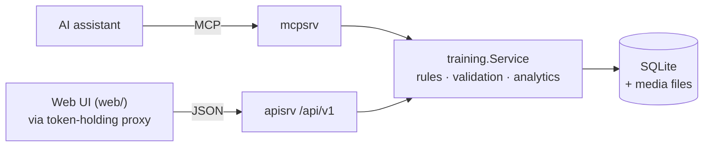

# workout-body

An open-source, self-hosted **engine for managing your own training**: a
deterministic workout log with plans, history and statistics, exposed to an AI
assistant through **MCP** and to a future mobile app through a documented
**HTTP API**. One user, one SQLite file, no cloud, no LLM inside the engine.

> **Builds on [Training MCP](https://github.com/FullFran/training-mcp)** by
> Francisco Manuel Olmedo Cortés (MIT). This project keeps its architecture,
> store and many features, and adds the pieces listed under
> [What this adds](#what-this-adds). Attribution and what changed:
> [NOTICE.md](NOTICE.md). The upstream README is kept as
> [UPSTREAM_README.md](UPSTREAM_README.md).

## Status

| Layer | Status |
|---|---|
| Engine (rules, persistence, plans, workouts, sets, analytics) | **Working, tested** |
| MCP server (50 tools, HTTP + stdio) and Claude Code plugin files | **Working, tested** with the official Go MCP client. Installing the plugin in Claude Code, and other clients, are **not verified** — see [docs/plugin-setup.md](docs/plugin-setup.md) |
| HTTP JSON API with OpenAPI spec | **Working, tested** |
| Web UI (`web/`, Hebrew RTL, mobile-first) | **Working against the engine** through the HTTP API, verified by a browser end-to-end flow against a real server. Runs behind a local proxy that holds the token; **not yet hardened for public hosting** (no login of its own) — see [web/README.md](web/README.md) |
| Upstream PWA (`internal/websrv`) | Inherited, optional, off by default; **not** the future UI and not extended |

## What you can do

Say things like these to an assistant connected to the MCP server:

1. "Bench press, first set: 8 reps at 60 kg. Planning 3 sets."
2. "Second set, same."
3. "Third set, same. Starting squats: 130 kg, 4 reps, planning 3 sets."
4. "Actually, bench set two was 7 reps."

Result: one workout for today (in your timezone) with bench press holding three
completed sets, the second corrected to 7 reps, and squats **planned** as 3×4 at
130 kg with **no** completed sets. The assistant turns your words into explicit
values; the engine validates and stores them. See
[docs/mcp-examples.md](docs/mcp-examples.md).

Also: keep a simple **nutrition log** (calories and macros per meal, daily targets that apply from a date forward, daily summaries — [docs/nutrition.md](docs/nutrition.md)), log a daily **body weight** and read weekly averages with the week-over-week change ([docs/weight.md](docs/weight.md)), give a plan a fixed schedule (fixed weekdays or N times a week) and see what is due this week, import/export plans as JSON, read planned-vs-completed progress, look at
exercise history and progression, attach a video to a set, and keep written
instructions plus how-to videos per exercise.

## What this adds

* **One workout per local date**, enforced by the database, with a configurable
  timezone (default `Asia/Jerusalem`); safe under simultaneous first writes.
* **Partial records:** weight, reps, RPE and RIR are optional; *missing is not
  zero*. Set types (warm-up, working, back-off, drop, failure) and notes.
* **Retry-safe writes** (idempotency keys) and **no silent overwrites**
  (per-record revisions, `If-Match` / `expected_revision`).
* **Stable exercise identities** with aliases; near-miss names are reported, never
  merged silently.
* **Planned vs performed** kept apart; plan edits never rewrite history. Planned
  target weight and RIR.
* **Plan JSON import/export** with a JSON Schema, all-errors validation and
  atomic apply.
* **Statistics:** exercise progression, best performances, training summaries;
  warm-ups handled explicitly.
* **JSON HTTP API** (OpenAPI 3.1, contract-tested), **MCP tools** with
  annotations and actionable errors, stdio mode, a **Claude Code plugin** with
  assistant instructions.
* **Videos** per set and **instructions + how-to videos** per exercise.
* Backup command, WAL SQLite, integration and end-to-end test suites.

## Architecture



MCP and HTTP are thin adapters over the same service, so they cannot disagree
about a rule, and edits from either side are protected by the same revisions.
Details: [docs/architecture.md](docs/architecture.md).

## Quick start

Requires Go 1.26+ (no CGO, no external services).

```sh
git clone <this repository> workout-body && cd workout-body
export MCP_BEARER_TOKEN="$(openssl rand -hex 32)"
export TRAINING_DB_PATH=./data/workout.db
go run ./cmd/training-mcp            # listens on :8080
```

In another shell:

```sh
curl -s localhost:8080/health
curl -s -H "Authorization: Bearer $MCP_BEARER_TOKEN" localhost:8080/api/v1/config

# import the example plan, then log a set
curl -s -X POST localhost:8080/api/v1/plans/import \
  -H "Authorization: Bearer $MCP_BEARER_TOKEN" -H "Content-Type: application/json" \
  --data-binary @docs/examples/plan-upper-lower.json
curl -s -X POST localhost:8080/api/v1/workouts/today/sets \
  -H "Authorization: Bearer $MCP_BEARER_TOKEN" -H "Content-Type: application/json" \
  -d '{"sets":[{"exercise":"bench press","weight_kg":60,"reps":8}]}'
curl -s -H "Authorization: Bearer $MCP_BEARER_TOKEN" localhost:8080/api/v1/workouts/today
```

Run the web UI against it: [web/README.md](web/README.md) (`cd web && npm install && WORKOUT_API_TOKEN="$MCP_BEARER_TOKEN" npm run dev`).
Connect an assistant: [docs/plugin-setup.md](docs/plugin-setup.md). Docker:
[docs/deployment.md](docs/deployment.md).

## Configuration

| Variable | Default | Purpose |
|---|---|---|
| `MCP_BEARER_TOKEN` | required (not for `--stdio`) | Static bearer token for `/mcp` and `/api/v1` |
| `WORKOUT_TIMEZONE` | `Asia/Jerusalem` | IANA zone that decides the workout date |
| `TRAINING_DB_PATH` | `~/.local/share/training-mcp/training.db` | SQLite file |
| `MEDIA_DIR` | `media/` beside the database | Uploaded videos |
| `MAX_VIDEO_MB` | `200` | Upload size limit |
| `MCP_AUTH_DISABLED=1` | off | Development only |
| `WEB_BASE_PATH` | unset | Mounts the optional upstream PWA |

Flags: `--addr :8080`, `--stdio`. Commands: `backup <file>`, `media-gc`. See
[.env.example](.env.example).

## Documentation

* [Product specification](docs/product-spec.md) · [Architecture](docs/architecture.md)
* [Engine and data model](docs/engine.md) · [Analytics](docs/analytics.md)
* [HTTP API](docs/http-api.md) ([OpenAPI](internal/apisrv/openapi.yaml)) ·
  [MCP tools](docs/mcp-tools.md) · [MCP examples](docs/mcp-examples.md)
* [Nutrition tracking](docs/nutrition.md) · [Body weight](docs/weight.md)
* [Plan format](docs/plan-format.md) ([schema](docs/schemas/workout-plan.v1.schema.json),
  [example](docs/examples/plan-upper-lower.json)) · [Videos and how-to](docs/media.md)
* [Plugin and client setup](docs/plugin-setup.md)
* [Development](docs/development.md) · [Deployment](docs/deployment.md) ·
  [Backup and restore](docs/backup-restore.md) · [Migrations](docs/migrations.md)
* [Audit of the upstream project and feature matrix](docs/audit.md)
* [Web UI](web/README.md)
* [Contributing](CONTRIBUTING.md) · [Security policy](SECURITY.md) · [Attribution](NOTICE.md)

## Security in one paragraph

A single static bearer token guards the API and MCP; there is no OAuth or
multi-user model. Run it behind HTTPS if it leaves your machine and never commit
tokens, `.env` files, databases or real training data. Details and reporting:
[SECURITY.md](SECURITY.md).

## License

MIT. Copyright (c) 2026 Francisco Manuel Olmedo Cortés (upstream) and workout-body
contributors. See [LICENSE](LICENSE).
