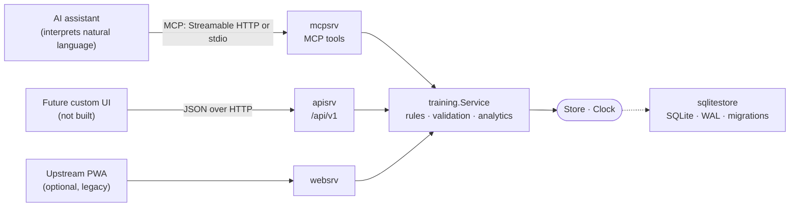

# Architecture

The dependency arrow points inwards. `training` imports no adapter and no
database driver; `sqlitestore` implements its `Store` port. The MCP and HTTP
adapters translate protocol details (JSON shapes, status codes, tool schemas)
and nothing else, which is how the two interfaces provably share the same rules,
data and concurrency behaviour.

## Packages

| Package | Role |
|---|---|
| `internal/training` | Domain model, validation, service, plan JSON, analytics. Pure Go. |
| `internal/sqlitestore` | SQLite adapter, embedded migrations, transactions. |
| `internal/mcpsrv` | MCP tools (Go MCP SDK), Streamable HTTP handler and stdio runner. |
| `internal/apisrv` | `/api/v1` JSON API and embedded OpenAPI spec. |
| `internal/httpsrv` | Outer router, bearer authentication, body limits, `/health`. |
| `internal/websrv` | Upstream server-rendered PWA (optional, not extended). |
| `internal/config` | Environment configuration, timezone loading. |
| `cmd/training-mcp` | Entry point: `serve` (default), `--stdio`, `backup`, `media-gc`. |
| `plugin/workout-body` | Claude Code plugin: MCP config and assistant skill. |

## Key decisions

**1. Extend the upstream engine instead of rewriting it.** Training MCP already
had ports-and-adapters, a migration runner, plan-to-session copying and a good
test culture. The new capabilities are an additive migration plus service
methods, so existing data migrates in place (see [migrations.md](migrations.md)).

**2. One workout per date is a database constraint, not a convention.** A
`UNIQUE` index on `sessions(date)` plus `INSERT … ON CONFLICT DO NOTHING` makes
concurrent first writes safe regardless of which adapter performs them. The
upstream code did list-then-insert and could create duplicates.

**3. Missing is not zero.** Weight, reps, RPE and RIR are nullable columns and
pointer types. Nothing is defaulted; derived values (SI, e1RM, volume) are
computed only from what was recorded.

**4. Planned and performed data are separate.** Prescriptions live in
`session_items`; performed sets in `sets`. Progress is computed by joining them.
Starting from a plan copies, never links.

**5. Idempotency keys instead of content de-duplication.** Two identical sets in
a row are legitimate (set 2 "same as set 1"), so duplicates cannot be detected by
content. An explicit key bound to the request payload makes retries safe while
leaving intentional repetition possible.

**6. Optimistic concurrency with revisions.** Single-user does not mean
single-writer: the assistant and a phone UI may both edit. A per-row `revision`
(returned as `ETag`, accepted as `If-Match` / `expected_revision`) turns silent
lost updates into explicit conflicts.

**7. SQLite, WAL, immediate transactions, no extra services.** One file, one
process, easy to back up. `BEGIN IMMEDIATE` plus `busy_timeout` serializes
writers without lock-upgrade deadlocks. A database server or broker has no
concrete need for one user.

**8. Hand-written OpenAPI, embedded and contract-tested.** No code generator or
heavy dependency; a test asserts that every registered route is documented and
vice versa.

**9. Conversational behaviour lives in the plugin instructions;
deterministic integrity lives in the engine.** The assistant resolves "same as
before" and asks clarifying questions; the engine validates, normalizes and
rejects.

**10. Exercise names stay the join key for legacy tables, ids are the stable
identity.** Adding an `exercises` table with aliases fixed fragmentation without
re-keying every upstream table; renames update all references in one
transaction.

## Testing strategy

* `internal/integration` — the engine on a real SQLite file, no mocks:
  concurrency, timezone boundaries, idempotency, migration from legacy data.
* `internal/apisrv`, `internal/mcpsrv` — adapters driven by real HTTP and MCP
  clients over a real store.
* `internal/e2e` — the acceptance flow across both adapters on one database.
* Unit tests in `training` for pure logic.
